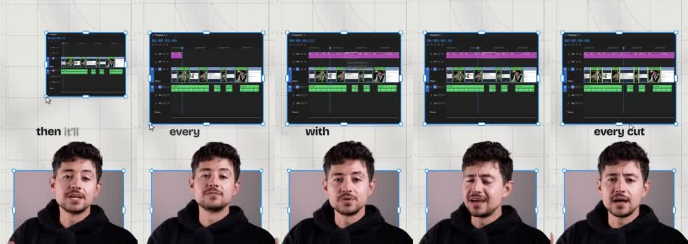

# v03_s08 · frame_split · 16.1–18.6s (calidad 4)

- **Guion:** Then it'll pull every caption with its timing, every cut,
- **Qué se ve:** [obs] Lienzo claro + cara; ventana con una línea de tiempo de editor (pistas moradas de captions, miniaturas de vídeo, pistas verdes de audio).
- **Diseño:** [obs] Ventana 82.6 × 37.5 % (y 13.2–50.7 %); caption oscura y≈54 %; 'timing' gris→negro.
- **Efectos:** [obs] Lienzo claro con cuadrícula.
- **Animación:** [obs] Corte en 16.03; ventana nace al ~60 % y crece con cursor (16.06–16.4); playhead avanza; pistas aparecen por capas (captions 16.75, cortes 18.3).
- **Por qué aquí:** [inf] Explicación técnica con cara: lo que extrae, mostrado como timeline real.
