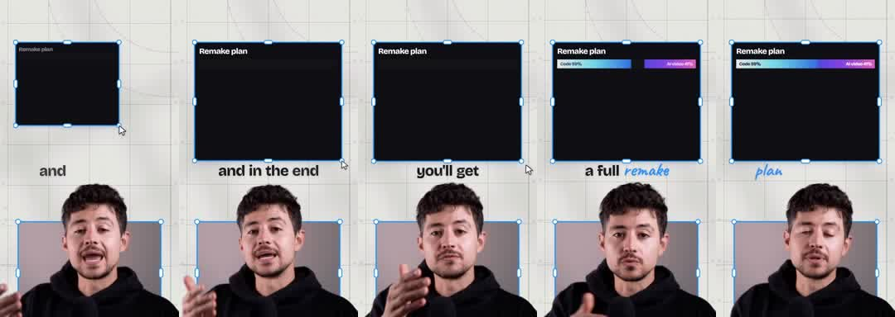

# v03_s11 · frame_split · 25.2–27.2s (calidad 3)

- **Guion:** and in the end, you'll get a full remake plan
- **Qué se ve:** [obs] Lienzo claro + cara; ventana oscura 'Remake plan' vacía y luego barra degradada 'Code 50% … AI video 41%'. 'remake' y 'plan' en serif itálica azul.
- **Diseño:** [obs] Ventana 82.6 × 37.5 %; barra con degradado azul→morado.
- **Efectos:** [obs] Lienzo claro.
- **Animación:** [obs] Corte en 25.14; ventana crece desde ~60 % (25.14–25.6); barra se llena 26.25–26.5.
- **Por qué aquí:** [inf] Resultado final anunciado → vuelve la cara.
