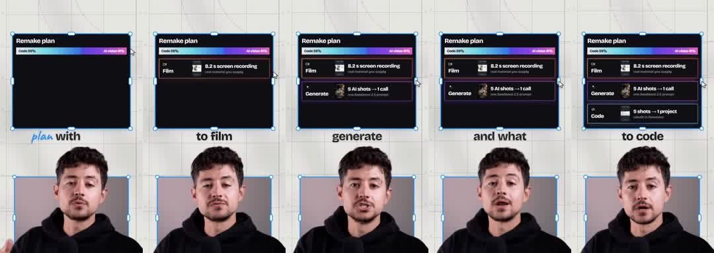

# v03_s12 · frame_split · 27.2–29.6s (calidad 4)

- **Guion:** with what to film, what to generate, and what to code.
- **Qué se ve:** [obs] En 'Remake plan' aparecen 3 filas: 'Film · 8.2 s screen recording', 'Generate · 5 AI shots → 1 call', 'Code · 5 shots → 1 project'.
- **Diseño:** [obs] Filas oscuras con borde fino rosa/morado e icono.
- **Efectos:** [obs] Ninguno.
- **Animación:** [obs] Cada fila entra en su palabra: Film ~27.75 ('film'), Generate ~28.25 ('generate'), Code ~29.25 ('code').
- **Por qué aquí:** [inf] Lista dicha = filas que aparecen.
