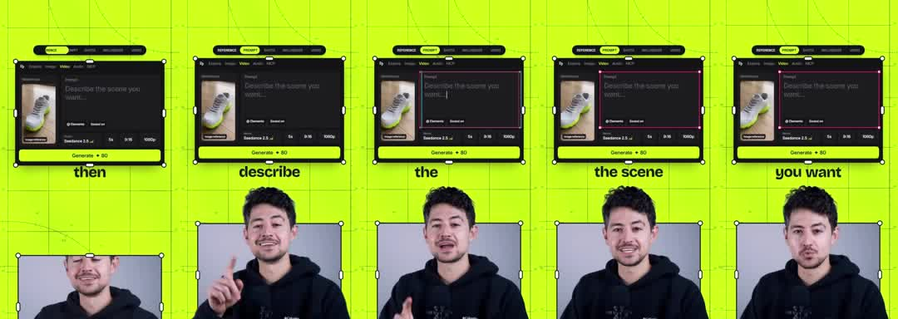

# v04_s05 · frame_split · 7.2–8.4s (calidad 4)

- **Guion:** Then describe the scene you want,
- **Qué se ve:** [obs] La ventana pasa a la pestaña PROMPT (campo 'Describe the scene you want…' con marco magenta) y el recuadro de Nick vuelve a subir desde abajo.
- **Diseño:** [obs] Barra de pasos y≈15 %, ventana y 18.1–51.8 %, caption y≈54 %, cara top 69.8 %.
- **Efectos:** [obs] Al entrar la cara: aberración cromática / separación RGB con tinte cian 2–3 frames (7.33–7.45).
- **Animación:** [obs] 7.12 la ventana se reduce a ~85 % y vuelve a crecer con el contenido nuevo (7.12–7.3); el recuadro de cara sube desde fuera de cuadro (7.25–7.5) con glitch RGB.
- **Por qué aquí:** [inf] Paso explicativo → vuelve la cara; el glitch RGB da energía a su regreso.
