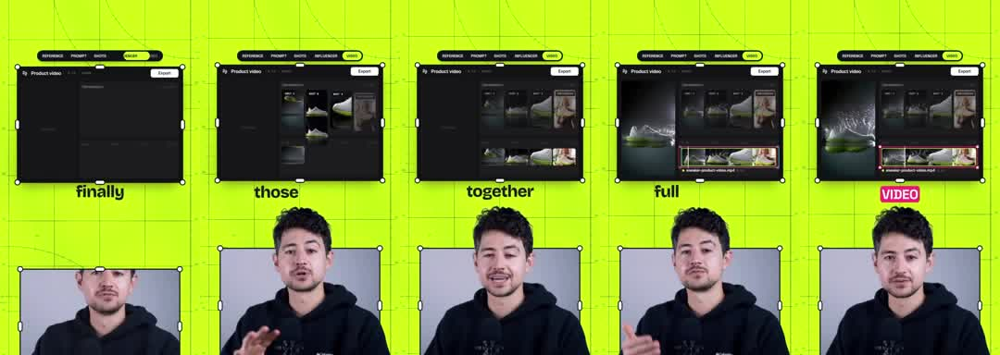

# v04_s12 · frame_split · 20.4–23.0s (calidad 4)

- **Guion:** Finally, put all those shots together in a one full product video
- **Qué se ve:** [obs] Vuelve el lima con cara; barra de pasos con VIDEO activa; ventana 'Product video' (editor con generaciones arriba y línea de tiempo abajo) que se va llenando con los planos.
- **Diseño:** [obs] Ventana y 18.1–51.8 %; caption y≈54 %; 'SHOTS', 'VIDEO' en caja magenta.
- **Efectos:** [obs] Glitch RGB/cian en la entrada de la cara (20.5–20.77).
- **Animación:** [obs] Corte en 20.37; ventana crece desde ~85 % (20.37–20.6); cara sube desde abajo con glitch RGB (20.5–20.77); clips entran en la timeline 21.3–22.0 y vista previa grande 22.0.
- **Por qué aquí:** [inf] Último paso con cara (cierre del proceso).
