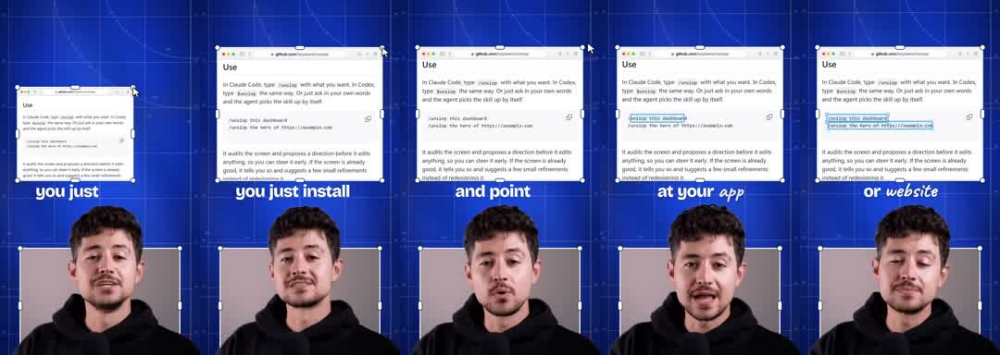

# v05_s06 · frame_split · 12.2–14.1s (calidad 3)

- **Guion:** You just install it and point it at your app or website,
- **Qué se ve:** [obs] Vuelve la cara; ventana con la sección 'Use' del README y los comandos '/unslop this dashboard' resaltados. 'app', 'website' serif itálica.
- **Diseño:** [obs] Ventana x≈10–89 %, y 13.1–51 %; caption y≈54 %; cara top 69.8 %.
- **Efectos:** [obs] Ninguno.
- **Animación:** [obs] Corte en 12.1; ventana nace al ~60 % y crece con cursor en esquina sup-der (12.1–12.5); resaltado del comando 13.9.
- **Por qué aquí:** [inf] Paso de uso con cara.
