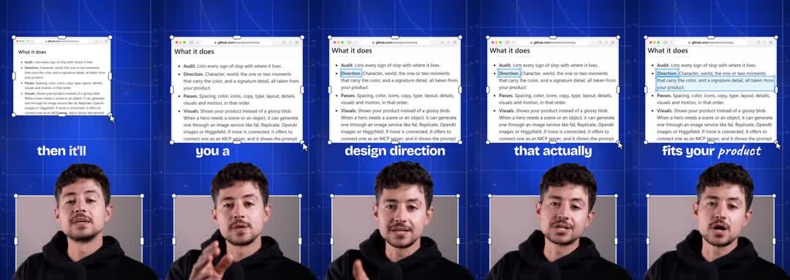

# v05_s09 · frame_split · 20.1–23.1s (calidad 3)

- **Guion:** Then it'll pitch you a premium design direction that actually fits your product.
- **Qué se ve:** [obs] Vuelve la cara; ventana con el README 'What it does' (Audit, Direction, Passes, Visuals) y se resalta 'Direction'. 'premium', 'product' serif itálica.
- **Diseño:** [obs] Ventana y 13.1–51 %; caption y≈54 %.
- **Efectos:** [obs] Ninguno.
- **Animación:** [obs] Corte en ~19.95; ventana crece desde ~60 % (19.95–20.4); resaltado en 'Direction' ~21.3.
- **Por qué aquí:** [inf] Paso explicativo con cara.
