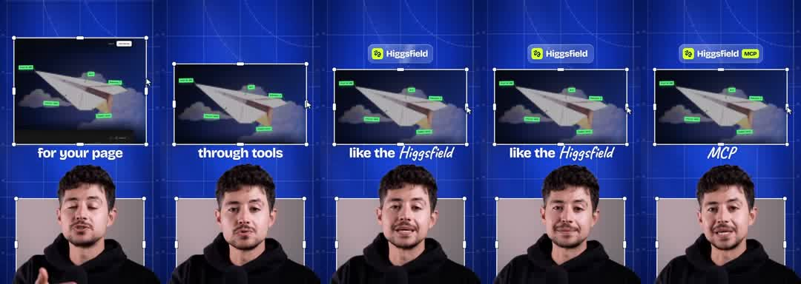

# v05_s14 · frame_split · 34.4–36.4s (calidad 3)

- **Guion:** through tools like the Higgs Field MCP.
- **Qué se ve:** [obs] Encima de la ventana aparece una píldora con el logo 'Higgsfield' (verde lima) y luego la etiqueta 'MCP'. 'Higgsfield', 'MCP' serif itálica.
- **Diseño:** [obs] Píldora azul oscuro con logo lima, y≈7–10 %, centrada sobre la ventana.
- **Efectos:** [obs] Ninguno.
- **Animación:** [obs] Logo pop 35.0; etiqueta 'MCP' se añade 36.0.
- **Por qué aquí:** [inf] Nombra una herramienta concreta → su logo.
