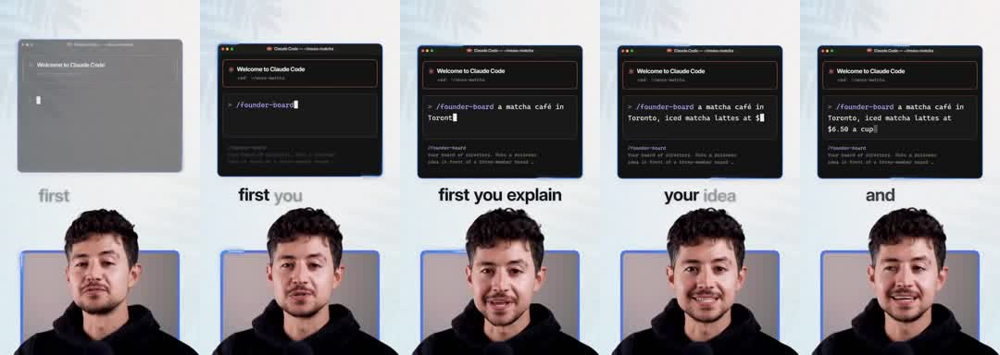

# v06_s07 · frame_split · 11.8–13.2s (calidad 4)

- **Guion:** First you explain your idea, and then
- **Qué se ve:** Vuelve al lienzo claro: ventana terminal 'Welcome to Claude Code' donde se teclea '/founder-board a matcha café in Toronto, iced matcha lattes at $6.50 a cup'; él abajo en recuadro. (observado 11.75–13.0)
- **Diseño:** Geometría frame_split: ventana y ~25–51 %, caption negro ~54 %, cara y 71 %→. 'explain' entra gris→negro.
- **Efectos:** Sombras de palmera; terminal oscura con texto mono.
- **Animación:** Ventana entra como rectángulo gris translúcido que se llena de contenido en ~0.25 s (fade + desenfoque, observado 11.75–12.0). Typing caracter a caracter del comando.
- **Por qué aquí:** Paso 1 del proceso → vuelve la cara (anuncia) mientras se ve la acción de escribir.
