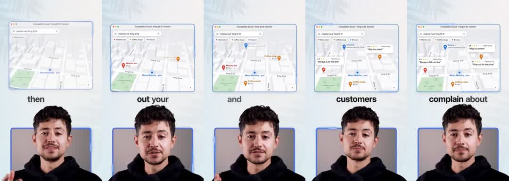

# v06_s10 · frame_split · 18.3–21.1s (calidad 5)

- **Guion:** Then it maps out your competitors and what their customers complain about.
- **Qué se ve:** Lienzo claro: ventana 'Competitor Scout · King St W, Toronto' con mapa 3D (pins de 'Matcha bar $7.25', 'Moss Matcha · you') y luego burbujas de queja ('Always a 20 min line'…). (observado 18.0–21.0)
- **Diseño:** Ventana más alta: y 13.1–50.6 % (37.5 % alto), x 9–91 %; caption negro ~54 %; 'competitors' serif itálica azul. (medido en 19.0)
- **Efectos:** Sombras de palmera; mapa claro.
- **Animación:** Entra como rectángulo gris translúcido → mapa (0.25 s); pins caen/aparecen al decir 'competitors' (18.9–19.5) y burbujas a 'complain' (20.5). (observado)
- **Por qué aquí:** 'Mapea a la competencia' = un mapa literal.
