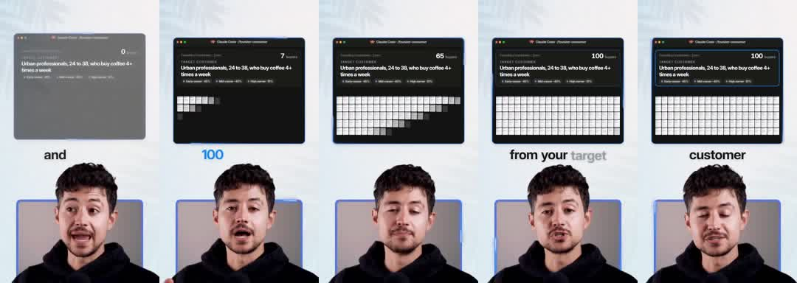

# v06_s11 · frame_split · 21.1–24.1s (calidad 4)

- **Guion:** And it builds a hundred different buyers from your target customer,
- **Qué se ve:** Ventana terminal 'Target customer: Urban professionals, 24 to 38, who buy coffee 4+ times a week' y una rejilla de celdas blancas que se llena fila a fila con contador 0→100. (observado 21.0–23.75)
- **Diseño:** Ventana y ~13–44 %; caption '100' en azul sans; resto negro.
- **Efectos:** Igual lienzo claro.
- **Animación:** Ventana entra gris translúcida → nítida (~0.25 s, observado 21.0–21.25); celdas aparecen por filas (~2 s) sincronizadas con el contador.
- **Por qué aquí:** Dato (100 compradores) construido delante del espectador.
