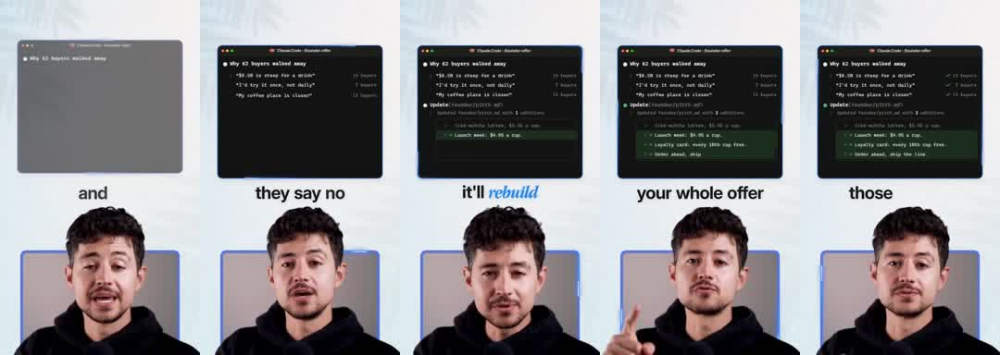

# v06_s16 · frame_split · 33.1–35.9s (calidad 4)

- **Guion:** And if they say no, it'll rebuild your whole offer around those doubts
- **Qué se ve:** Lienzo claro: terminal '/founder-offer' con 'Why 62 buyers walked away' y citas, luego 'Update(founder/pitch.md)' con líneas verdes de diff (Launch week $4.95, Loyalty card…). (observado 33.0–35.75)
- **Diseño:** Ventana y ~13–44 %; caption negro ~54 %; 'rebuild' serif itálica azul.
- **Efectos:** Sombras de palmera; diff verde.
- **Animación:** Ventana gris translúcida → contenido (0.25 s); líneas del diff entran una a una (~0.3 s).
- **Por qué aquí:** Cambio de acción (reconstruir) → vuelve la cara + se ve el código cambiando.
