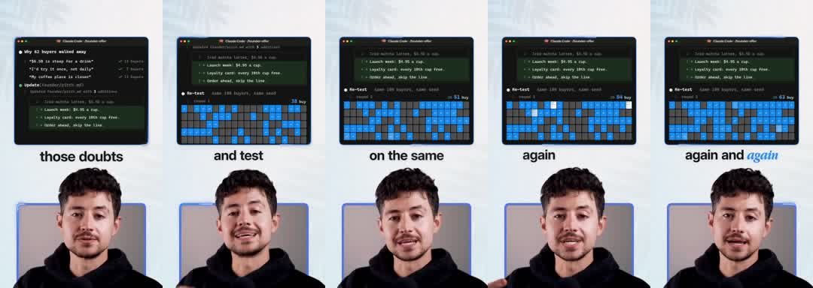

# v06_s17 · frame_split · 35.9–38.0s (calidad 4)

- **Guion:** and test it on the same buyers again and again.
- **Qué se ve:** La terminal se desplaza hacia arriba y aparece 'Re-test · same 100 buyers, same seed' con la rejilla re-coloreándose (48 buy). (observado 36.0–37.75)
- **Diseño:** Segundo 'again' en serif itálica azul. (observado 37.75)
- **Efectos:** —
- **Animación:** Scroll del contenido de la ventana (~0.3 s) y rejilla que parpadea por rondas.
- **Por qué aquí:** Iteración → repetición visual (rondas de test).
