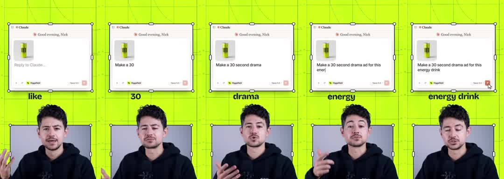

# v07_s06 · frame_split · 12.4–15.1s (calidad 4)

- **Guion:** make a 30-second drama ad for this energy drink,
- **Qué se ve:** Lima: ventana de Claude ('Good evening, Nick') con la lata adjunta y prompt que se teclea 'Make a 30 second drama ad for this energy drink'; él abajo. (observado 12.5–14.75)
- **Diseño:** Ventana y≈24–51 %, asas blancas; caption y≈54 %.
- **Efectos:** —
- **Animación:** Corte seco a 12.43; typing sincronizado con la voz palabra a palabra; cursor pulsa enviar a 14.5.
- **Por qué aquí:** Muestra el prompt literal mientras lo dice.
