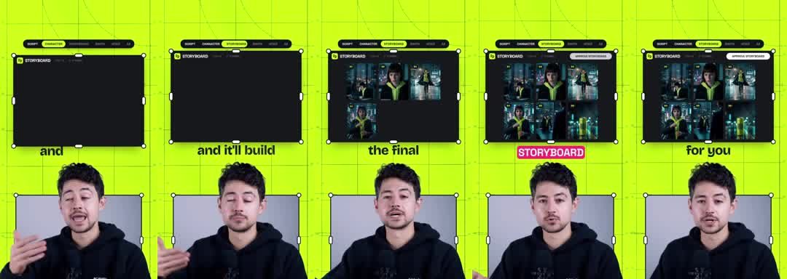

# v07_s10 · frame_split · 23.2–25.1s (calidad 4)

- **Guion:** and it'll build the final storyboard for you.
- **Qué se ve:** Lima con cara: ventana oscura 'STORYBOARD' que empieza vacía y se llena con 6 viñetas del drama (23.75–24.5); pestaña STORYBOARD activa encima. (observado)
- **Diseño:** Pestañas y≈15.5 %; ventana y≈18–51 %; caption y≈54.5 %; 'STORYBOARD' caja magenta.
- **Efectos:** —
- **Animación:** Ventana vacía crece y las viñetas aparecen en cascada (~0.15 s cada una).
- **Por qué aquí:** Construcción visible del storyboard.
