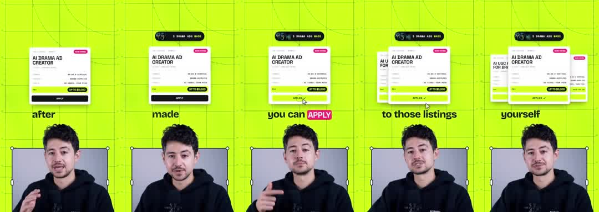

# v07_s16 · frame_split · 31.6–33.7s (calidad 4)

- **Guion:** After you've made it through, you can apply to those listings yourself
- **Qué se ve:** Chip negro '3 DRAMA ADS MADE' y tarjeta de oferta 'AI DRAMA AD CREATOR'; el cursor pulsa APPLY → 'APPLIED ✓'; luego se abren en abanico 3 ofertas. (observado 31.5–34.0)
- **Diseño:** Tarjeta ~50 % ancho centrada y≈22–42 %; 'APPLY' caja magenta.
- **Efectos:** Sombras de tarjetas.
- **Animación:** Tarjeta pop; clic; abanico (las tarjetas se separan lateralmente ~0.3 s).
- **Por qué aquí:** Cierra el bucle con la oferta del hook (callback).
