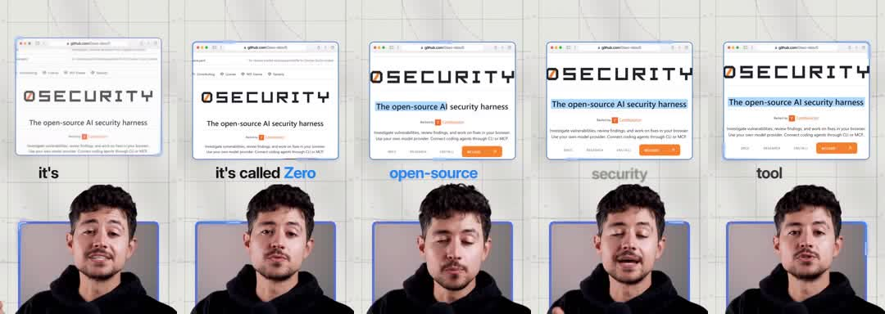

# v08_s04 · frame_split · 7.9–10.5s (calidad 4)

- **Guion:** It's called Xero, and it's an open source AI security tool
- **Qué se ve:** Lienzo claro: navegador GitHub con logo '0SECURITY' y 'The open-source AI security harness' resaltado en azul (9.0). Él abajo. (observado 7.75–10.25)
- **Diseño:** Ventana y 13.3–50.8 % (sin título); logo pixel/mono negro grande; caption 'open-source' azul, 'Zero' en caption.
- **Efectos:** Cuadrícula clara.
- **Animación:** Ventana entra como rectángulo blanco translúcido (opacidad ~30 %→100 %) en ~0.25 s (7.75–8.0); resaltado de frase a 9.0.
- **Por qué aquí:** Nombre + descripción → página real con la frase subrayada.
