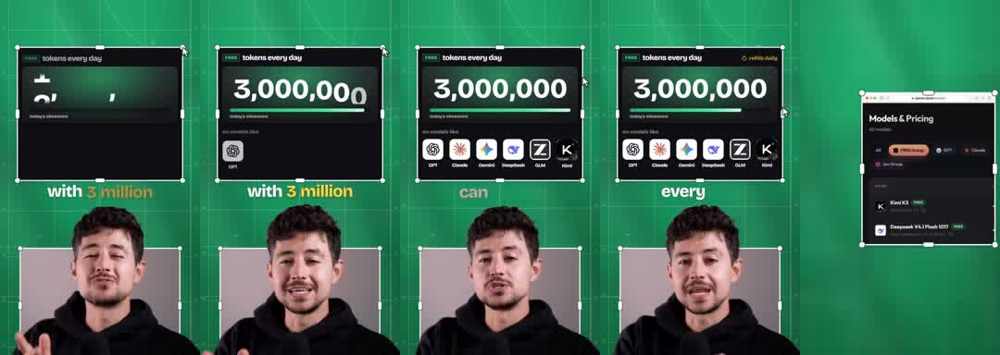

# v09_s04 · frame_split · 7.6–9.9s (calidad 5)

- **Guion:** 3 million tokens you can spend every day.
- **Qué se ve:** Vuelve la cara: tarjeta oscura 'tokens every day' con contador que rueda 0 → 3,000,000, barra de progreso verde, logos de modelos y chip 'refills daily' (9.25). (observado 7.25–9.5)
- **Diseño:** Cifra sans bold blanca enorme; caption '3 million' amarillo, y≈54 %.
- **Efectos:** Degradado verde interior en la tarjeta.
- **Animación:** Ventana aparece con 'dígitos en blanco' (0, , ) y rueda en ~0.75 s; logos pop en fila (8.0–8.5).
- **Por qué aquí:** Dato grande = contador vivo.
