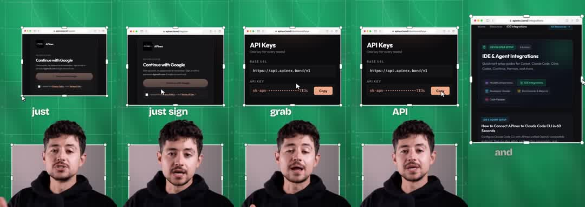

# v09_s08 · frame_split · 16.9–18.8s (calidad 4)

- **Guion:** Just sign up, grab your API key,
- **Qué se ve:** Vuelve la cara: ventana 'Continue with Google' (sign up) y luego página 'API Keys' con base URL y clave enmascarada; el cursor pulsa 'Copy' → 'Copied'. (observado 16.85–18.5)
- **Diseño:** Ventana y≈27–51 %; caption blanco y≈54 %.
- **Efectos:** —
- **Animación:** Ventana sign-in con escala desde pequeño (~0.25 s); corte interno a API Keys (17.75); clic de cursor.
- **Por qué aquí:** Pasos simples mostrados como acción de 1 clic.
