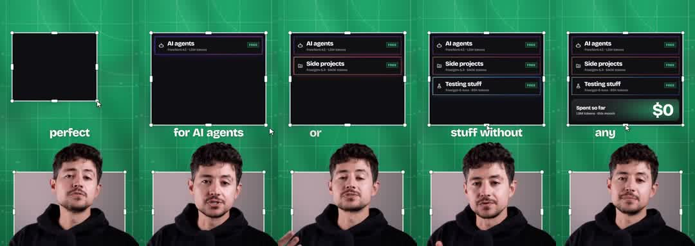

# v09_s10 · frame_split · 22.3–26.2s (calidad 4)

- **Guion:** Perfect for AI agents, side projects, or just testing stuff without having to spend any money.
- **Qué se ve:** Vuelve la cara: ventana oscura vacía que se rellena con filas 'AI agents' (22.75), 'Side projects' (23.5), 'Testing stuff' (24.25), cada una con chip FREE y borde de color; al final tarjeta 'Spent so far $0' (25.5). (observado)
- **Diseño:** Filas con borde morado/rosa/azul; '$0' blanco grande; caption 'money' amarillo.
- **Efectos:** —
- **Animación:** Ventana vacía 0.5 s; filas fade+slide (~0.2 s) al decir cada caso; tarjeta $0 sube desde abajo.
- **Por qué aquí:** Casos de uso enumerados + remate del beneficio ($0).
