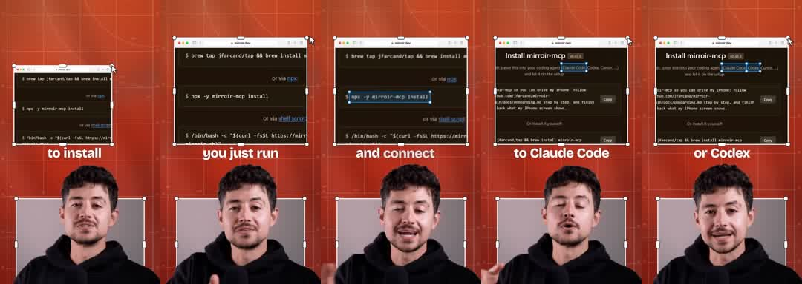

# v10_s06 · frame_split · 11.5–14.8s (calidad 4)

- **Guion:** To install it, you just run this one command and connect it to Cloud Code or Codex.
- **Qué se ve:** Lienzo naranja con cara: terminal con 'brew tap…', 'npx -y mirroir-mcp install' (enmarcado en azul con asas, 12.5) y '/bin/bash…'; a 13.5 cambia a 'Install mirroir-mcp' con 'Claude Code, Codex, Cursor' resaltado (14.0). (observado)
- **Diseño:** Ventana y≈27–51 %; 'one' script itálica; caption y≈54 %.
- **Efectos:** —
- **Animación:** Ventana entra con escala desde ~70 % (11.4–11.8); marco de selección; cambio de página con fade.
- **Por qué aquí:** 'Un comando' = un solo comando enmarcado.
