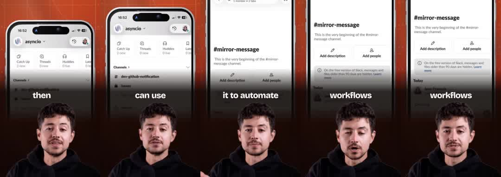

# v10_s07 · frame_split · 14.8–16.5s (calidad 4)

- **Guion:** Then you can use it to automate whole workflows,
- **Qué se ve:** Variante sin recuadro: grabación de pantalla del iPhone (Slack 'asyncio' → canal #mirror-message) ocupando la mitad superior a sangre, que se funde por degradado oscuro con él a ancho completo abajo. (observado 14.75–16.25)
- **Diseño:** Captura y 0–~48 %, degradado negro 40–60 %; cara full-width abajo; caption blanco y≈54 %.
- **Efectos:** Degradado negro de fusión entre captura y A-roll.
- **Animación:** Corte seco 14.75; scroll de la app.
- **Por qué aquí:** Ejemplos de uso → pantallas reales, con la cara presente.
