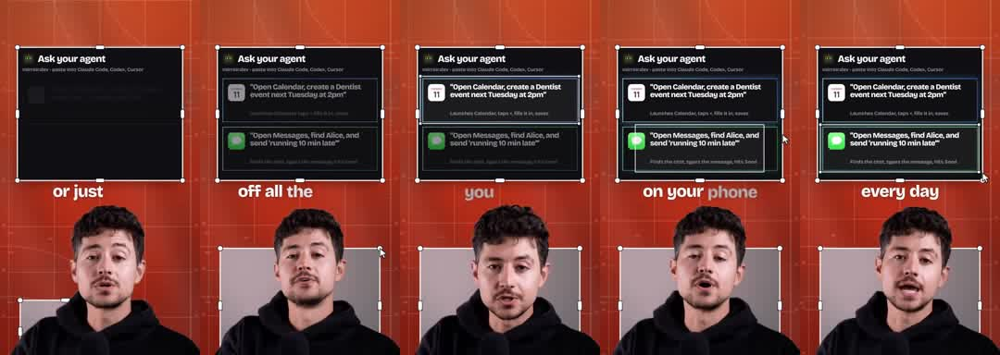

# v10_s10 · frame_split · 18.2–21.3s (calidad 4)

- **Guion:** just hand off all the boring stuff that you have to do in your phone every day.
- **Qué se ve:** Vuelve el lienzo naranja con recuadro: ventana oscura 'Ask your agent' vacía que recibe dos tarjetas de prompt ('Open Calendar, create a Dentist event…', 'Open Messages, find Alice…'), cada una se resalta. (observado 18.25–21.0)
- **Diseño:** Ventana y≈13–51 %; 'boring' script itálica; caption y≈54 %.
- **Efectos:** —
- **Animación:** Ventana vacía → tarjetas fade+slide (18.5, 18.75); contorno blanco sobre cada tarjeta (19.25, 20.5).
- **Por qué aquí:** Tareas aburridas concretas como prompts reales.
