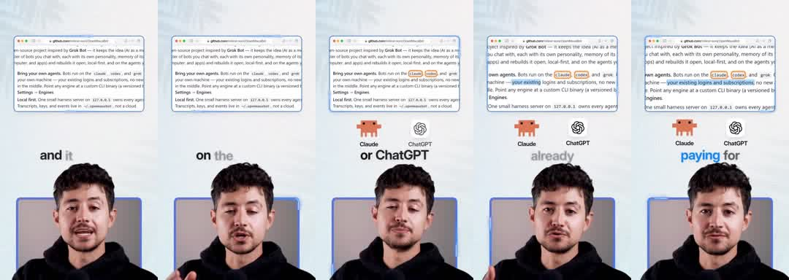

# v11_s04 · frame_split · 5.3–8.4s (calidad 4)

- **Guion:** and it all runs on the Clauter Chat GPT plan you're already paying for.
- **Qué se ve:** [obs 5.25–8.0] Vuelve el lienzo claro: ventana con README de GitHub (texto 'Bring your own agents...'); se resaltan 'claude' y 'codex' con cajas naranjas; bajo la ventana aparecen iconos de Claude (cangrejo naranja) y ChatGPT; luego 'your existing logins and subscriptions' se resalta en azul.
- **Diseño:** Ventana blanca x 8.7–91.3 %, y≈13–42 %; iconos ~8 % ancho bajo la ventana con etiqueta gris pequeña; subtítulo negro y≈55 %; 'paying' en azul.
- **Efectos:** [obs] Lienzo claro con grano; resaltados de texto tipo marcador (cajas naranjas redondeadas, fondo azul claro).
- **Animación:** [obs 6.25] icono Claude pop al decir 'Claude'; [obs 6.75] ChatGPT pop al decir 'Chat GPT' (ícono previo atenuado); [obs 7.75] resaltado azul se extiende sobre la frase; ventana con scroll/desplazamiento lateral leve.
- **Por qué aquí:** [inf] Dato de coste (usa tu suscripción) se prueba con el README y con logos reconocibles.
