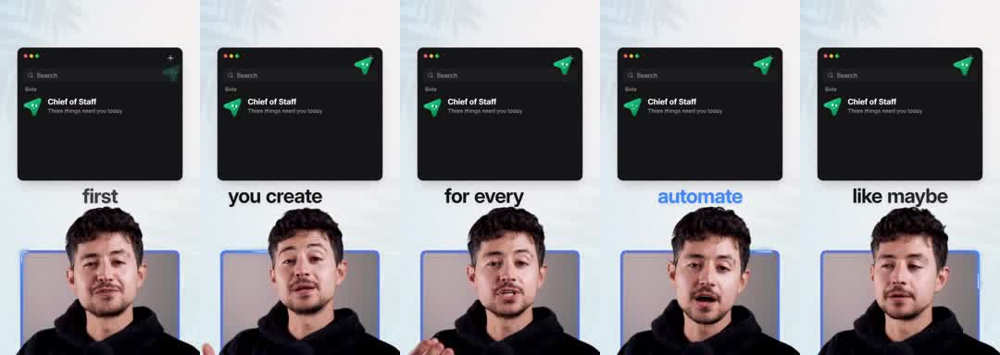

# v11_s07 · frame_split · 11.9–14.5s (calidad 3)

- **Guion:** First you create a bot for every job you want to automate, like maybe
- **Qué se ve:** [obs 11.75–14.25] Lienzo claro; ventana oscura de la app con buscador y sección 'Bots' con un solo bot 'Chief of Staff'; él en el recuadro.
- **Diseño:** [medido 13.0] Ventana #19191B x 8.8–91.2 %, y 13.4–50.8 %, radio ~30 px, sin borde azul; subtítulo sans bold negra ~5 % en y≈55 %, 'automate' en azul.
- **Efectos:** [obs] Grano en lienzo; palabra siguiente gris desenfocada.
- **Animación:** [obs 11.75] corte seco; icono bot verde con destello '+' arriba-derecha; subtítulo write-on con blur-in.
- **Por qué aquí:** [inf] Anuncia el paso 1 → vuelve la cara con la app de fondo.
