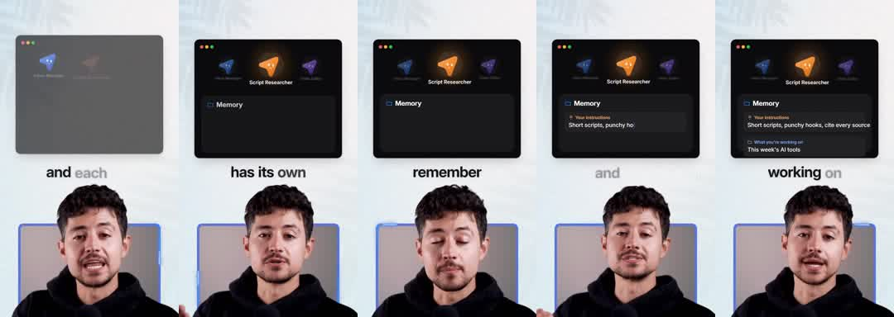

# v11_s12 · frame_split · 26.3–30.0s (calidad 4)

- **Guion:** And each bot has its own memory, so it can remember your instructions and what you're working on.
- **Qué se ve:** [obs 26.25–29.75] Lienzo claro: ventana con carrusel de bots (Inbox Manager, Script Researcher, Video Editor) que se centra en Script Researcher; panel 'Memory' donde se escriben 'Your instructions: Short scripts, punchy hooks, cite every source' y 'What you're working on: This week's AI tools'.
- **Diseño:** Ventana oscura y 13.4–37 %; 'memory' en azul; subtítulos negros y≈55 %.
- **Efectos:** [obs 26.25] placeholder gris translúcido antes del contenido.
- **Animación:** [obs 26.25–26.5] ventana gris vacía → fade del contenido (≈0.2 s); carrusel desliza (26.75–27.0); typing del texto de memoria (28.5–29.75).
- **Por qué aquí:** [inf] Nueva característica anunciada (cara visible) + prueba en la app.
