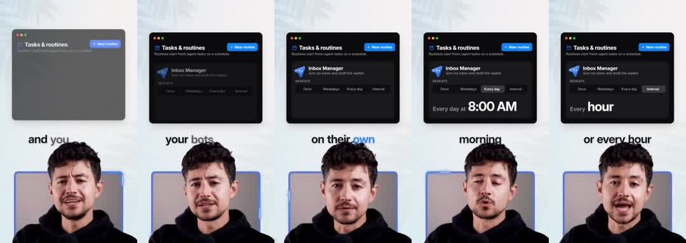

# v11_s15 · frame_split · 34.0–37.2s (calidad 4)

- **Guion:** and you can set your bots to run on their own, like every morning or every hour.
- **Qué se ve:** [obs 34.0–36.75] Lienzo claro: ventana 'Tasks & routines' con Inbox Manager y selector Once/Weekdays/Every day/Interval; se selecciona 'Every day' y aparece 'Every day at 8:00 AM' grande; luego 'Interval' → 'Every hour'.
- **Diseño:** Ventana y 13–37 %; botón azul '+ New routine'; '8:00 AM' sans bold blanca grande dentro de la ventana; 'own' en azul.
- **Efectos:** [obs 34.0] placeholder gris translúcido.
- **Animación:** [obs] placeholder → contenido (0.25 s); selección de píldora sincronizada con 'every morning' (36.0) y 'hour' (36.75); el texto '8:00 AM' sube desde abajo (slot) en 36.0.
- **Por qué aquí:** [inf] Automatización programada mostrada como ajuste concreto.
