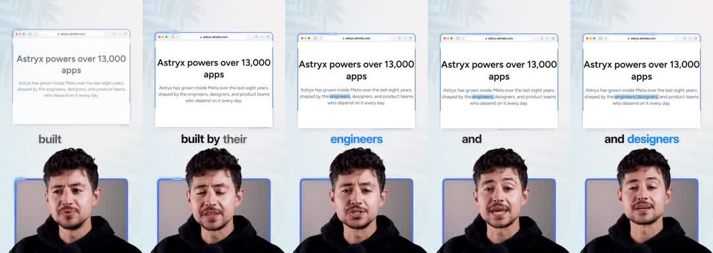

# v12_s06 · frame_split · 12.0–13.4s (calidad 3)

- **Guion:** built by their engineers and designers
- **Qué se ve:** [obs 12.0–13.25] Vuelve lienzo claro + recuadro de cara; ventana con texto de la web 'Astryx powers over 13,000 apps' donde se resaltan en azul 'engineers, designers'.
- **Diseño:** [medido 13.0] Ventana x 8.8–91 %, y 13.3–37 %; subtítulo negro y≈55 %, 'engineers'/'designers' en azul.
- **Efectos:** [obs 12.0] placeholder gris translúcido.
- **Animación:** [obs 12.0–12.25] placeholder → contenido (fade 0.2 s); resaltado azul tipo marcador barre las palabras al decirlas.
- **Por qué aquí:** [inf] Cita la fuente literal mientras lo dice.
