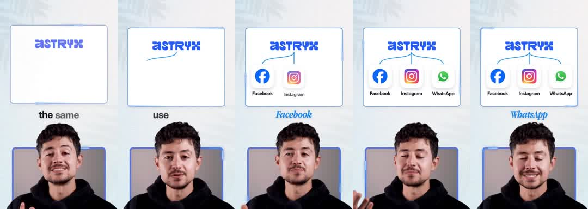

# v12_s11 · frame_split · 21.4–24.4s (calidad 5)

- **Guion:** the same ones they use across Facebook, Instagram, and even WhatsApp.
- **Qué se ve:** [obs 21.5–24.0] Lienzo claro + cara; ventana blanca con logotipo ASTRYX del que se dibuja una línea ramificada azul hacia los iconos de Facebook, Instagram y WhatsApp.
- **Diseño:** Iconos app ~8 % ancho con etiqueta gris; línea azul fina; subtítulos 'Facebook', 'Instagram', 'WhatsApp' en serif itálica azul (blur-in).
- **Efectos:** [obs 21.5] placeholder gris; sin textura en ventana.
- **Animación:** [obs] línea se dibuja (stroke ≈0.3 s) a 22.0; Facebook pop 22.25, Instagram 22.75, WhatsApp 23.75, sincronizados a la palabra.
- **Por qué aquí:** [inf] Mapa visual de adopción: marcas conocidas = credibilidad.
