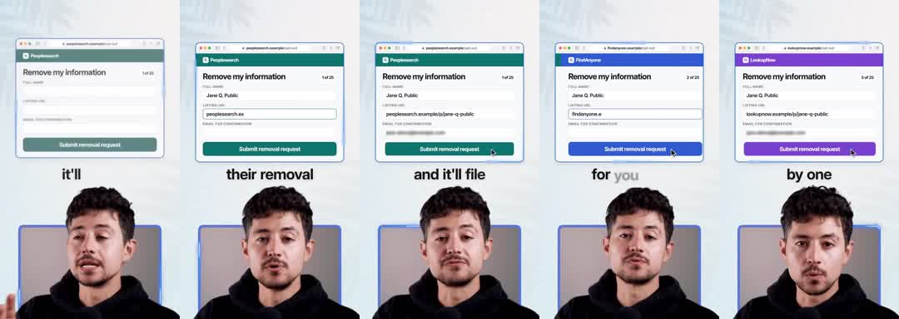

# v13_s10 · frame_split · 22.9–26.1s (calidad 5)

- **Guion:** It'll open their removal forms, and it'll file the request for you one by one.
- **Qué se ve:** [obs 22.75–25.75] Lienzo claro + cara: formulario 'Remove my information 1 of 25' que se autocompleta, el cursor pulsa 'Submit removal request' → botón verde 'Request sent'; luego el formulario se desliza a la izquierda y entran otros (azul 'Findanyone', morado 'Lookupnow').
- **Diseño:** Ventana y 13.3–30 %; botones verde #2E9E5B, azul #2D5BE3, morado #7B3FE0 aprox.
- **Efectos:** [obs 22.75] placeholder gris.
- **Animación:** [obs] typing de campos 23.25–24.0; clic 24.25; 'Request sent' 24.75; carrusel horizontal 25.0–25.75 (un formulario cada ~0.35 s).
- **Por qué aquí:** [inf] 'one by one' literal: carrusel de formularios.
