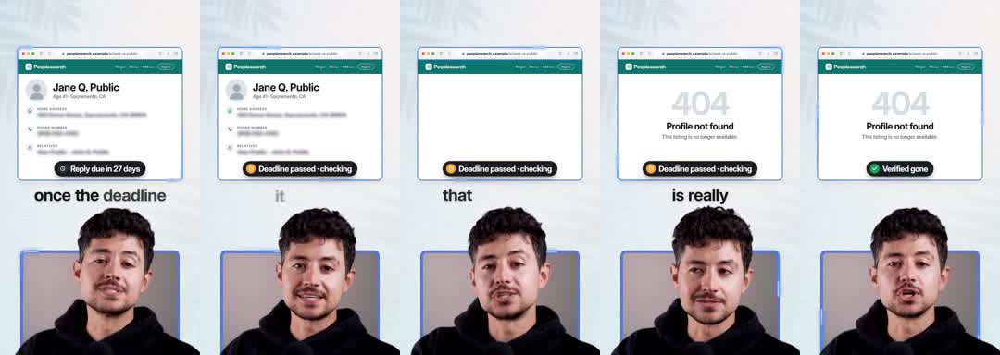

# v13_s13 · frame_split · 31.9–35.3s (calidad 5)

- **Guion:** Once the deadline passes, it goes back to check that your listing is really gone for good.
- **Qué se ve:** [obs 32.0–35.0] Lienzo claro + cara: perfil con chip 'Reply due in 31 days' → '7 days' → 'Deadline passed · checking' (punto naranja) → página '404 Profile not found' → chip 'Verified gone' (verde).
- **Diseño:** Chip negro píldora con texto blanco y punto de estado; '404' gris grande; 'gone for good' serif itálica.
- **Efectos:** [obs] perfil se atenúa antes del 404.
- **Animación:** [obs] chips cambian 32.0, 32.25, 32.5; 404 33.75; 'Verified gone' 34.75.
- **Por qué aquí:** [inf] Muestra la secuencia de estados (antes → después).
