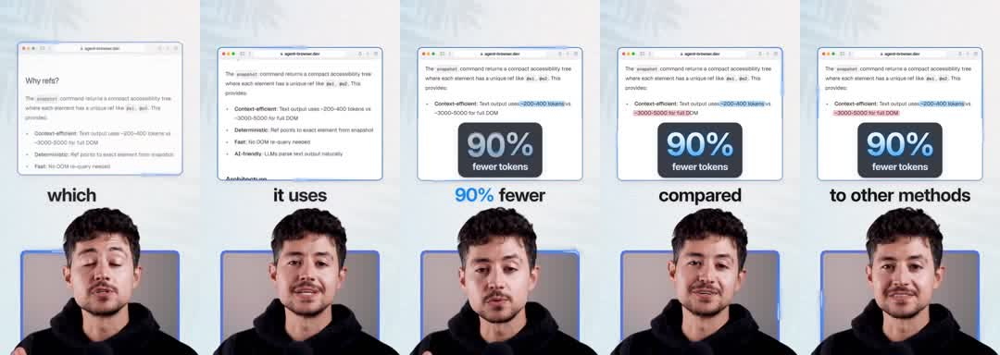

# v14_s12 · frame_split · 28.3–31.6s (calidad 5)

- **Guion:** which is why it uses 90 % fewer tokens compared to other methods.
- **Qué se ve:** [obs 28.25–31.25] Lienzo claro + cara: documentación 'Why refs?'; se resalta en azul '200-400 tokens' y en rojo '3000-5000'; tarjeta oscura '90% fewer tokens' con contador.
- **Diseño:** Tarjeta gris oscura #2A2A2E redondeada con '90%' sans bold blanca ~5 % alto; '90%' azul en subtítulo.
- **Efectos:** [obs 28.25] placeholder gris.
- **Animación:** [obs] resaltado azul 29.25, contador '88%→90%' 29.25–29.75, resaltado rojo 30.75.
- **Por qué aquí:** [inf] Dato de ahorro con prueba en la doc.
