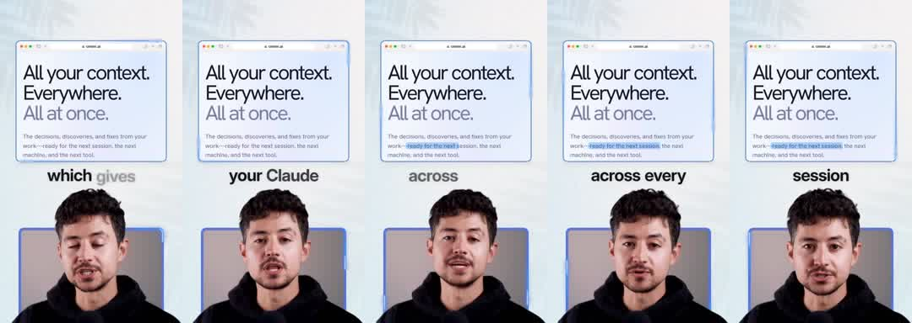

# v15_s04 · frame_split · 6.0–8.0s (calidad 3)

- **Guion:** gives your cloud memory across every session,
- **Qué se ve:** [obs 5.75–7.75] Lienzo claro + cara: web 'All your context. Everywhere. All at once.'; se resalta 'ready for the next session'.
- **Diseño:** Ventana y 13.3–37 %; 'memory' serif itálica azul.
- **Efectos:** [obs] grano.
- **Animación:** [obs 5.75] corte; resaltado azul 7.0–7.25.
- **Por qué aquí:** [inf] Explica el beneficio con la cara visible.
