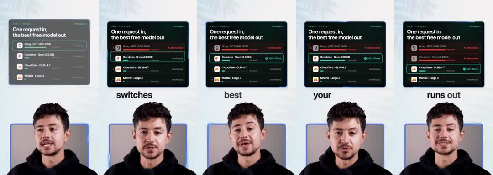

# v15_s09 · frame_split · 18.2–22.1s (calidad 4)

- **Guion:** and it automatically switches you to the next best model any time your usage limit runs out.
- **Qué se ve:** [obs 18.25–21.75] Lienzo claro + cara: tarjeta oscura 'One request in, the best free model out' con proveedores (Groq rate-limited en rojo, Cerebras seleccionado en verde, luego Cloudflare seleccionado).
- **Diseño:** Tarjeta oscura verde-negra #0F1A17 aprox. y 13.3–37 %; recuadros verdes de selección; 'automatically' serif itálica azul.
- **Efectos:** [obs 18.25] placeholder gris.
- **Animación:** [obs] selección pasa de Cerebras (19.25) a Cloudflare (21.0) cuando el anterior se marca rojo.
- **Por qué aquí:** [inf] 'switches' literal: la selección salta.
