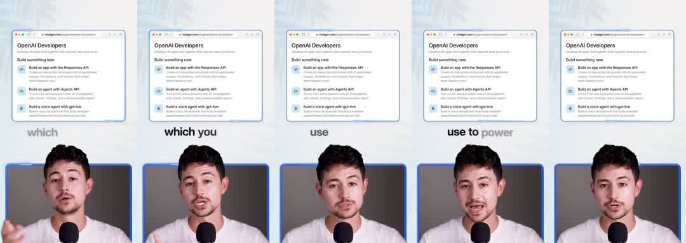

# v16_s08 · frame_split · 12.3–13.3s (calidad 3)

- **Guion:** Which you could use to power your
- **Qué se ve:** Vuelve el lienzo claro: ventana 'OpenAI Developers – Build something new' (3 tarjetas: Responses API, Agents API, voice agent) arriba, Nick en recuadro abajo. Caption 'which you could' / 'use to power'.
- **Diseño:** Ventana x 10–90 % × y 12.4–49.8 % (≈37 % alto, más grande al no haber título). Caption y≈55 %. Recuadro cara y 67.3 %→100 %.
- **Efectos:** Lienzo claro con palmera.
- **Animación:** [observed 12.27] corte seco desde lienzo oscuro.
- **Por qué aquí:** [inferred] Vuelve a cara+ventana al pasar a 'para qué sirve' (nuevo punto).
