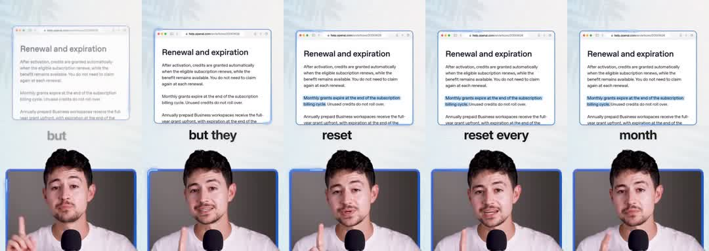

# v16_s13 · frame_split · 19.7–21.1s (calidad 4)

- **Guion:** But they reset every month,
- **Qué se ve:** Lienzo claro: ventana 'Renewal and expiration' (help.openai.com) + Nick en recuadro (levanta el dedo). Resaltado 'Monthly grants expire at the end of the subscription billing cycle'.
- **Diseño:** Ventana x 10–90 % × y ≈12–49 %; caption 'reset' ~y 54 %.
- **Efectos:** Palmera en lienzo.
- **Animación:** [observed 19.73–19.80] ventana entra con blur+fade (≈3 fr). [observed 20.13] highlight.
- **Por qué aquí:** [inferred] Advertencia (urgencia) → vuelve su cara para el tono de aviso.
