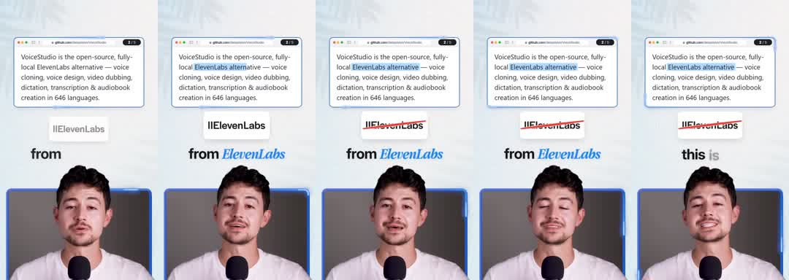

# v17_s09 · frame_split · 13.7–14.8s (calidad 4)

- **Guion:** 11labs. This is an
- **Qué se ve:** Lienzo claro: ventana con texto 'VoiceStudio is the open-source, fully-local ElevenLabs alternative…' (resaltado 'ElevenLabs alternative'); tarjeta-logo ElevenLabs que se tacha en rojo; Nick abajo.
- **Diseño:** Ventana x 10–90 %, y 13.3–38.9 %; logo y≈41–44 %; caption 'from ElevenLabs' (serif itálica azul) y≈55 %.
- **Efectos:** Palmera.
- **Animación:** [observed 13.67] corte seco desde blanco; [observed 13.8] logo pop; [observed 14.13] tachado rojo.
- **Por qué aquí:** [inferred] Ancla la alternativa a la marca cara que todos conocen.
