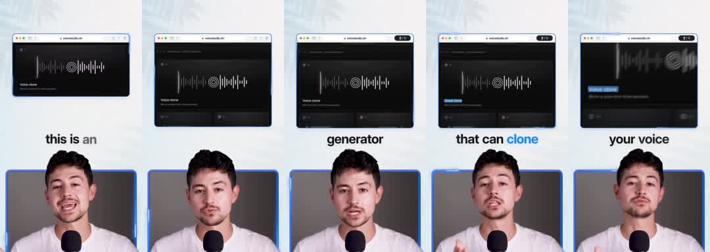

# v17_s10 · frame_split · 14.8–16.8s (calidad 3)

- **Guion:** AI voice generator that can clone your voice
- **Qué se ve:** La ventana pasa a vídeo oscuro de la app (forma de onda animada 'Voice clone'); Nick abajo.
- **Diseño:** Ventana igual; contenido oscuro dentro de marco azul. 'clone' azul.
- **Efectos:** —
- **Animación:** [observed 14.97] corte interno de la ventana; onda animada.
- **Por qué aquí:** [inferred] Literal: generador de voz = onda.
