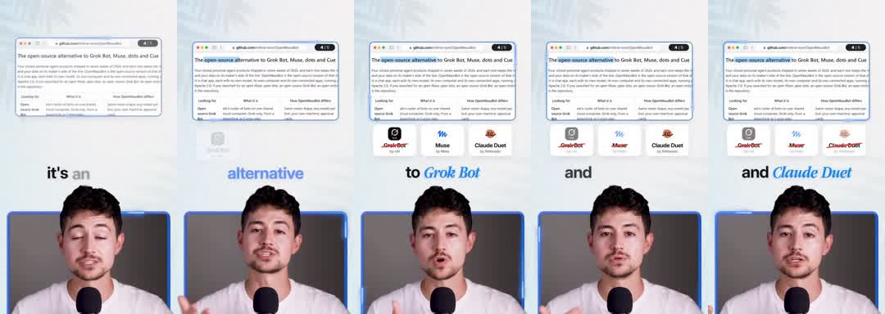

# v17_s18 · frame_split · 29.5–32.5s (calidad 5)

- **Guion:** It's an open source alternative to Grockbot, Muse, and Claude duet,
- **Qué se ve:** Lienzo claro: README 'The open-source alternative to Grok Bot, Muse, dots and Cue' (resaltado); debajo 3 tarjetas-logo (Grok Bot, Muse, Claude Duet) que se tachan una a una; Nick abajo.
- **Diseño:** Ventana y 13–38 %; logos y≈41–46 %; 'alternative' azul, 'Grok Bot', 'Claude Duet' serif itálica azul.
- **Efectos:** Palmera.
- **Animación:** [observed 29.47–29.6] crossfade blanco→lienzo claro (≈3 fr). [observed ~30.5–32.0] logos pop y tachado por nombre.
- **Por qué aquí:** [inferred] Literal: cada competidor nombrado se tacha.
