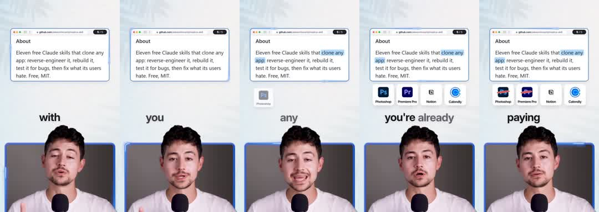

# v17_s23 · frame_split · 39.3–41.9s (calidad 5)

- **Guion:** With this, you can clone any app you're already paying for it
- **Qué se ve:** Lienzo claro: ventana 'About — Eleven free Claude skills that clone any app…'; 'clone any app' resaltado; debajo tarjetas Photoshop, Premiere Pro, Notion, Calendly que entran una a una y se tachan en rojo en 'paying'.
- **Diseño:** Ventana y≈12–33 %; tarjetas y≈36–42 %; caption y≈55 %.
- **Efectos:** Palmera.
- **Animación:** [observed 39.33–39.4] crossfade blanco→claro; [observed 40.5–41.0] logos pop secuencial; [observed 41.5] tachado.
- **Por qué aquí:** [inferred] 'apps que ya pagas' = marcas conocidas tachadas.
