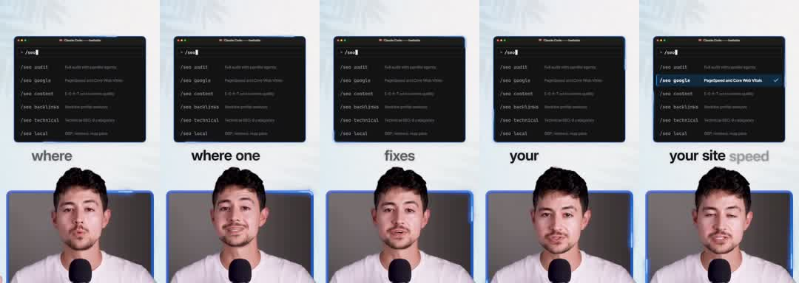

# v18_s07 · frame_split · 13.6–15.1s (calidad 4)

- **Guion:** Where one skill fixes your site speed,
- **Qué se ve:** Lienzo claro: terminal con la lista /seo audit, /seo google, /seo content, /seo backlinks, /seo technical, /seo local; Nick abajo. '/seo google — PageSpeed and Core Web Vitals' se ilumina con check.
- **Diseño:** Ventana x 10–90 %, y 12.8–50.2 %; fila activa con fondo azul oscuro y texto blanco + ✓.
- **Efectos:** Palmera.
- **Animación:** [observed 13.57] corte seco; [observed ~14.9] fila resaltada.
- **Por qué aquí:** [inferred] Enumeración: cada skill nombrada = su fila.
