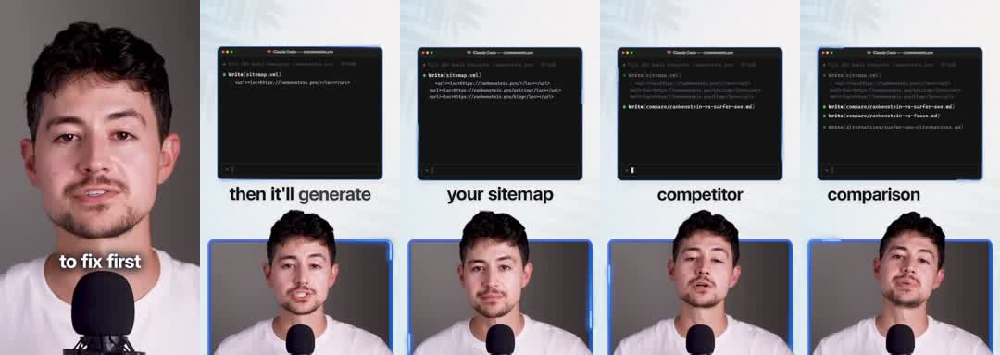

# v18_s15 · frame_split · 29.4–32.4s (calidad 4)

- **Guion:** Then it'll generate your site map, competitor comparison pages,
- **Qué se ve:** Lienzo claro: terminal que escribe 'Write(sitemap.xml)', 'Write(compare/rankenstein-vs-surfer-seo.md)'…; Nick abajo.
- **Diseño:** Ventana x 10–90 %, y≈12–40 %.
- **Efectos:** Palmera.
- **Animación:** [observed 29.6–29.93] ventana entra como rectángulo gris vacío que se rellena (fade ≈5 fr); líneas nuevas por palabra (30.5, 31.5, 32.0).
- **Por qué aquí:** [inferred] Cada entregable dicho = su línea.
