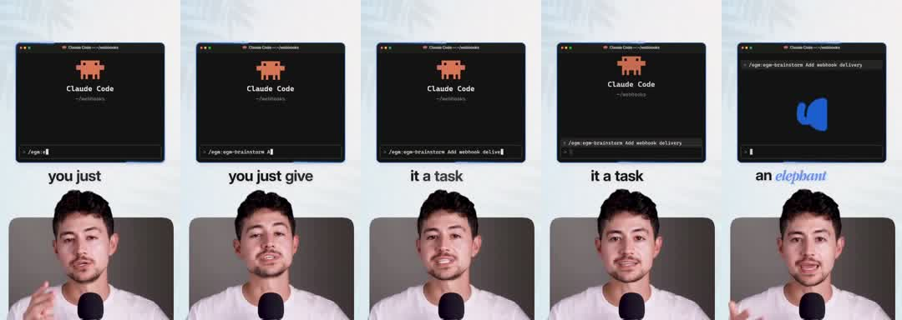

# v19_s08 · frame_split · 12.3–13.4s (calidad 3)

- **Guion:** You just give it a task and
- **Qué se ve:** Lienzo claro: terminal Claude Code ~/webhooks; se teclea '/ege:ege-brainstorm Add webhook delivery'.
- **Diseño:** Ventana x 10–90 %, y 13.3–50.8 %.
- **Efectos:** Palmera.
- **Animación:** [observed 12.23] corte seco; tecleo.
- **Por qué aquí:** [inferred] Inicio de la demo.
