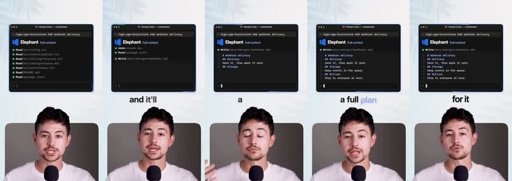

# v19_s10 · frame_split · 15.8–17.4s (calidad 3)

- **Guion:** and it'll write a full plan for it.
- **Qué se ve:** La terminal escribe 'Write(docs/designs/webhooks.md)' con secciones Delivery/Storage/Rollout.
- **Diseño:** 'plan' azul.
- **Efectos:** —
- **Animación:** [observed 16.0–17.0] líneas escritas.
- **Por qué aquí:** [inferred] Literal.
