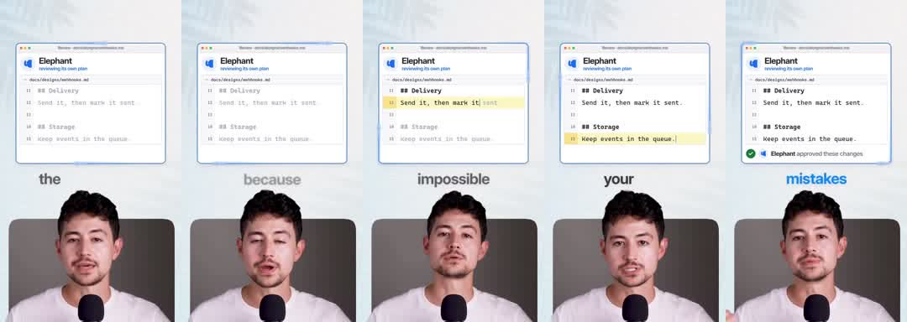

# v19_s14 · frame_split · 25.1–28.3s (calidad 4)

- **Guion:** And that's the whole point, because it's almost impossible to spot your own mistakes,
- **Qué se ve:** Lienzo claro: ventana 'Elephant – reviewing its own plan' (docs/designs/webhooks.md) con líneas resaltadas en amarillo una a una; al final 'Elephant approved these changes' con ✓ verde.
- **Diseño:** Resaltado amarillo pálido #FFF3C4; 'point', 'mistakes' azul.
- **Efectos:** Palmera.
- **Animación:** [observed 25.13] corte; [observed 26.0, 26.5, 27.0] resaltado amarillo baja línea a línea; [observed 28.0] check verde.
- **Por qué aquí:** [inferred] Ironía visual: el elefante revisa lo suyo y lo aprueba todo.
