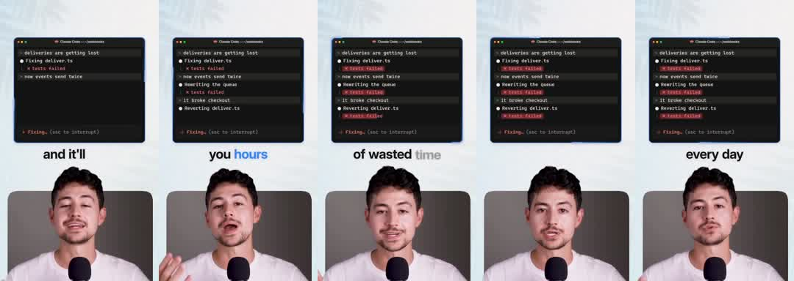

# v19_s18 · frame_split · 34.7–37.4s (calidad 4)

- **Guion:** and it'll save you hours of wasted time and tokens every day.
- **Qué se ve:** Lienzo claro: terminal con bucle de fallos ('deliveries are getting lost' → 'Fixing deliver.ts' → '× tests failed' → 'now events send twice' → '× tests failed' → 'it broke checkout'…) que se acumula.
- **Diseño:** Píldoras rojas '× tests failed'. 'tokens' azul.
- **Efectos:** Palmera.
- **Animación:** [observed 34.73] corte; [observed 34.8–35.2] líneas de fallo aparecen una tras otra.
- **Por qué aquí:** [inferred] Muestra el coste evitado (el 'antes' sin el método).
