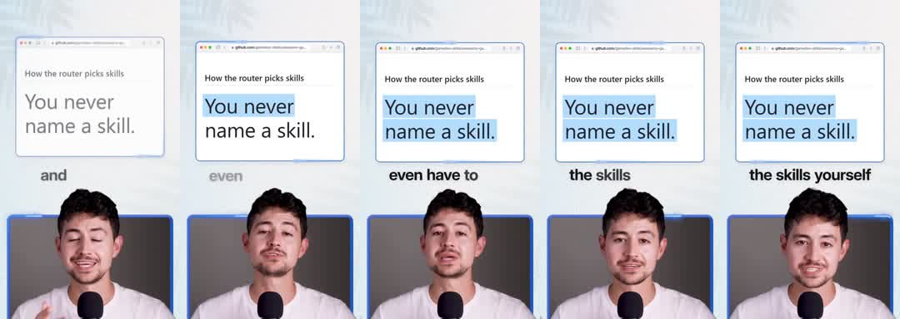

# v20_s06 · frame_split · 12.2–14.0s (calidad 4)

- **Guion:** And you never even have to pick the skills yourself.
- **Qué se ve:** Lienzo claro: ventana con 'How the router picks skills' y frase grande 'You never name a skill.' que se resalta en azul.
- **Diseño:** Texto sans regular ~4 % alto en la captura; resaltado azul claro. 'never' azul, 'pick' gris→negro.
- **Efectos:** Palmera.
- **Animación:** [observed 12.2–12.33] ventana fade-in desde blanco (≈3 fr); [observed 12.53] resaltado 'You never' y luego 'name a skill'.
- **Por qué aquí:** [inferred] La frase de la doc coincide con lo dicho: prueba literal.
