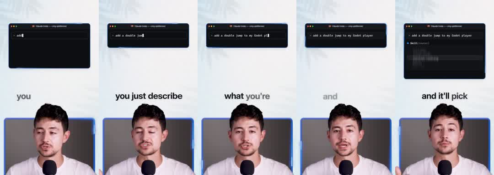

# v20_s07 · frame_split · 14.2–15.8s (calidad 4)

- **Guion:** You just describe what you're building and it'll pick
- **Qué se ve:** La ventana pasa a terminal: se teclea 'add a double jump to my Godot player'; aparece 'Skill(router)' con líneas cargando (blur).
- **Diseño:** Terminal negra x 10–90 %, y 13–28 % (se alarga al llenarse).
- **Efectos:** —
- **Animación:** [observed 14.2] corte interno; tecleo; [observed 15.0–15.5] líneas difuminadas pasan.
- **Por qué aquí:** [inferred] Demo literal de 'describe'.
