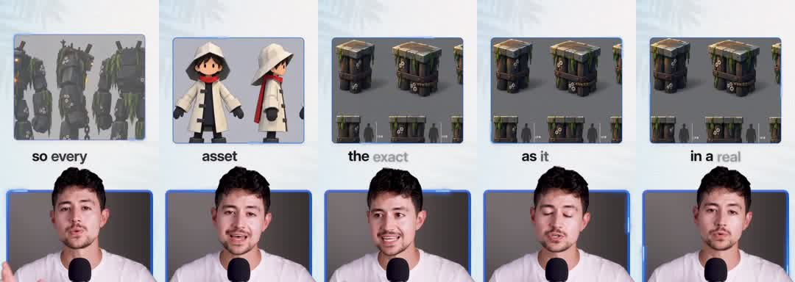

# v20_s12 · frame_split · 24.0–27.3s (calidad 4)

- **Guion:** So every game asset looks the exact same as it would in a real
- **Qué se ve:** Lienzo claro: la ventana muestra hojas de assets: mechs (24.0), personaje con abrigo en turnaround (24.5), cajas/barriles (25.5).
- **Diseño:** Ventana x 10–90 %, y≈13–50 %; fondo gris de render.
- **Efectos:** Palmera.
- **Animación:** [observed 24.0–24.27] ventana aparece por fade desde blanco/gris; cortes internos 24.5 y 25.5.
- **Por qué aquí:** [inferred] Prueba de calidad de assets.
