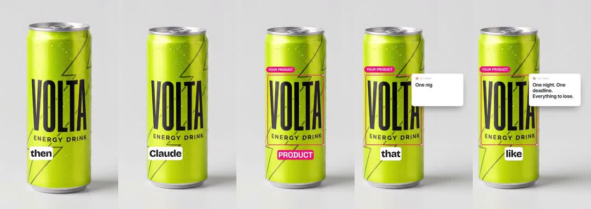

# v07_s05 · full_screen_capture · 9.6–12.4s (calidad 4)

- **Guion:** then explain Claude your product and the story that you want, like
- **Qué se ve:** Foto de producto a pantalla completa: lata 'VOLTA energy drink' lima sobre fondo gris claro. Al decir 'product' aparece marco de selección magenta 'YOUR PRODUCT'; al decir 'story' un globo blanco escribe 'One night. One deadline. Everything to lose.' (observado 9.5–12.25)
- **Diseño:** Captions en etiquetas blancas con texto negro (cada palabra su caja) a y≈55 %; 'PRODUCT' en caja magenta.
- **Efectos:** Foto de estudio limpia, sin grano.
- **Animación:** Corte seco a 9.5; marco de selección se dibuja (~0.2 s); typing en el globo ~1 s. (observado)
- **Por qué aquí:** 'Tu producto' = el producto real a pantalla completa (literal).
